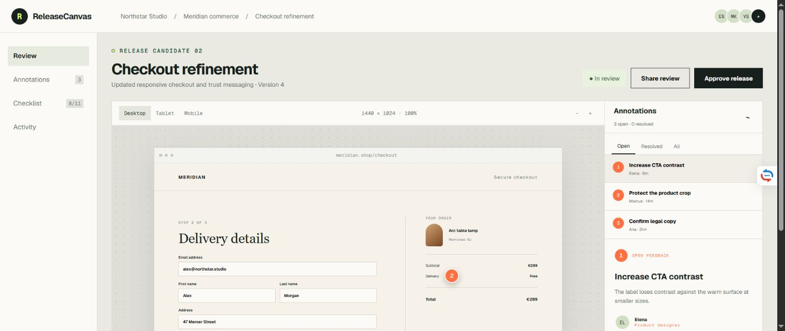
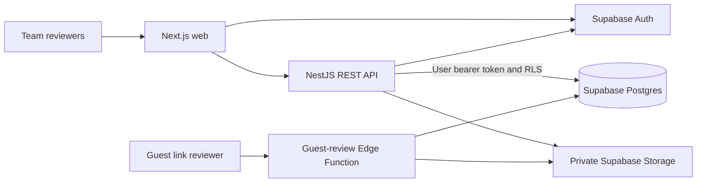
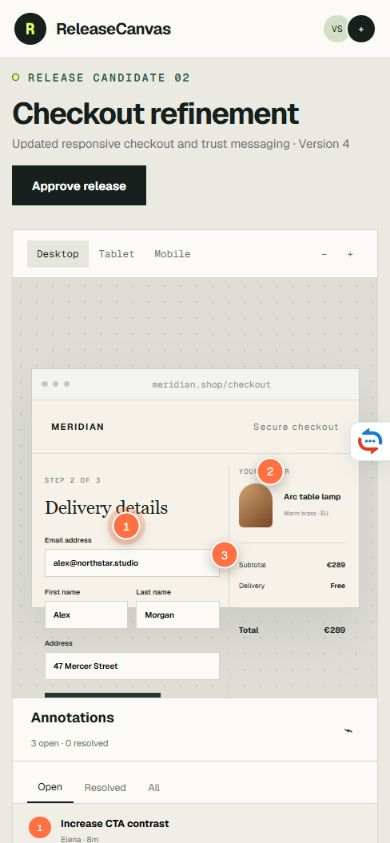

# ReleaseCanvas

A release-review workspace for agencies and product teams: upload interface screenshots, pin feedback, track issues, and record approval decisions before shipping.

**Next.js · React · TypeScript · NestJS · Supabase Auth · PostgreSQL · Private Storage**

[Source code](https://github.com/Scofari/release-canvas) · [Hosted recruiter demo](https://release-canvas.vercel.app/demo) · [Product URL](https://release-canvas.vercel.app) · [API health](https://release-canvas-api-production.up.railway.app/v1/health)

**Hosting status, checked 2026-10-20:** the web deployment returns **503 `DEPLOYMENT_PAUSED`**. The hosted demo is currently unavailable. The configured Railway API also returns **404 `Application not found`**. Use the local demo instructions below; the screenshots were captured from the production-mode local demo on this audit date.



## Why this exists

Feedback scattered across chat, email, and meetings is difficult to reconcile. ReleaseCanvas puts the artifact, discussion, checklist, and final decision in one workflow.

## Features and engineering evidence

- Authenticated workspaces and release management; tenant records carry `workspace_id`.
- Private screenshot uploads, image-content validation, and short-lived signed URLs.
- Versioned artifacts, positioned annotations, comments, and checklists.
- Expiring/revocable guest-review links whose bearer tokens are stored as hashes.
- Append-only approval records. The authenticated decision path uses a PostgreSQL transaction, a row lock, and an idempotency key.
- Shared Zod request/response contracts and a tested release state machine.
- Responsive portfolio demo using fictional data, with annotation selection, resolution, and approval gating.

The `/demo` route is a **client-state demonstration**, separate from the authenticated product. Its Share button displays a notification; it does not create a real guest link. Demo changes reset on reload. Toolbar/checklist labels in this route do not establish implemented connected behavior.

## Architecture



| Location | Responsibility |
| --- | --- |
| `apps/web` | Next.js 16 landing page, recruiter demo, authenticated workspace, guest UI |
| `apps/api` | NestJS REST API, OpenAPI docs, auth checks, upload validation, release services |
| `packages/contracts` | Shared Zod contracts and release state machine |
| `supabase/migrations` | Authoritative schema, tenant RLS, storage policies, authenticated decision function |
| `supabase/functions/guest-review` | Hashed-link guest access and guest decisions |

The configured deployment separates Vercel (web), Railway (Dockerized API), and Supabase (Postgres, Auth, private Storage, Edge Function). Configuration is not proof of current service availability.

## Local development

Requires **Node.js 22+** and **pnpm 11.16.0** as pinned in `package.json`. Docker is needed for the local connected Supabase stack, not the fictional demo itself.

### Interactive portfolio demo

From the repository root:

```sh
pnpm install --frozen-lockfile
```

Copy `.env.example` to **`apps/web/.env.local`**, then configure these browser-safe local values:

```dotenv
NEXT_PUBLIC_API_URL=http://localhost:4000/v1
NEXT_PUBLIC_SUPABASE_URL=http://127.0.0.1:54321
NEXT_PUBLIC_SUPABASE_PUBLISHABLE_KEY=local-demo-placeholder
```

```sh
pnpm --filter @release-canvas/web dev
```

Open [http://localhost:3000/demo](http://localhost:3000/demo). With no auth cookie, the demo uses component-local state; these placeholders do not enable sign-in, database access, uploads, or guest links. Use real local Supabase values for the connected product. Never place secret/service-role keys in `NEXT_PUBLIC_*` variables.

### Connected product

The root `.env.example` documents variable names; **a root `.env` is not automatically loaded by this NestJS entrypoint**. Next.js reads its application-root environment files. Configure both processes explicitly.

1. From the repository root, initialize a local Supabase configuration (`pnpm exec supabase init`) and start its Docker stack (`pnpm exec supabase start`). Existing SQL lives in `supabase/migrations`; apply pending local migrations with `pnpm exec supabase migration up --local`. Keep generated local keys private.
2. Replace the web placeholders in `apps/web/.env.local` with the local API URL, Supabase URL, and local publishable/anon key. Configure the Auth redirect to `http://localhost:3000/auth/callback`.
3. In a separate API terminal, set `SUPABASE_URL`, `SUPABASE_PUBLISHABLE_KEY`, `WEB_ORIGIN=http://localhost:3000`, and `PORT=4000` in the process environment, then run `pnpm --filter @release-canvas/api dev`. Use the values reported by your own local stack; never copy production credentials into the repository.
4. API documentation: [http://localhost:4000/docs](http://localhost:4000/docs). Health: [http://localhost:4000/v1/health](http://localhost:4000/v1/health). API health alone does not verify database/Auth/Storage operation.
5. Guest links additionally require the `guest-review` Edge Function. Review its configuration and the [security model](docs/SECURITY.md) before enabling it against a database.

The API source authenticates user requests using a publishable key plus the user's bearer token. The Edge Function uses its server-only service-role environment. `DATABASE_URL` and `SUPABASE_SECRET_KEY` in the example are not a substitute for those distinct access paths.

### Verification

```sh
pnpm lint
pnpm typecheck
pnpm test
pnpm build
```

`pnpm check` runs all four. The current `lint` scripts invoke TypeScript checking; they are **not an ESLint rule suite**. Tests cover contract/state transitions, demo approval policy, image signature/content validation, and release decision service behavior. They do not replace live cross-tenant, Auth, Storage, or guest-decision integration tests.

The committed CI also defines a local Supabase database job. Its result must be inspected separately; the workflow definition alone is not evidence of a passing run. See [this audit's verification record](docs/PORTFOLIO_AUDIT.md).

For production-mode web serving, run `pnpm build` first, then `pnpm --filter @release-canvas/web start`. The API build starts with `pnpm --filter @release-canvas/api start` and needs its server environment configured.

## Security model

Tenant rows carry `workspace_id`; API checks and Postgres RLS protect workspace data. Files are private and accessed through short-lived signed URLs. Guest tokens are stored only as hashes. SQL migrations include append-only decision protections. See [docs/SECURITY.md](docs/SECURITY.md).

The authenticated decision function uses `SECURITY INVOKER`, verifies authentication, locks the release row, rejects unresolved annotations, and records the decision/state change atomically. **The guest Edge Function uses a separate multi-request write path; equivalent transaction/race guarantees have not been established.** Harden and integration-test that path before depending on it for concurrent production approvals.

## Responsive review



[Screenshot provenance](docs/screenshots/README.md).

## Tradeoffs and limitations

- Screenshot review first; video/PDF and realtime presence are deferred.
- REST plus shared schemas makes the frontend/backend contract explicit without an additional RPC layer.
- SQL migrations own schema/security behavior. Although the initial overview referred to Drizzle, the current API performs data access through Supabase clients; no Drizzle runtime dependency is present.
- Billing is deferred. Usage-limit presentation is not evidence of payment collection or validated demand.
- Hosted web is paused. Connected deployment, migration, RLS, private-upload, and guest flows were not reverified against a live backend during this audit.
- Customer interviews, willingness to pay, and repeat usage remain unvalidated. See the preserved [delivery and customer-validation plan](docs/DELIVERY.md).

## License

Copyright © 2026 Vladimir Scofari. Source-available for portfolio review; no license is granted for commercial redistribution.
